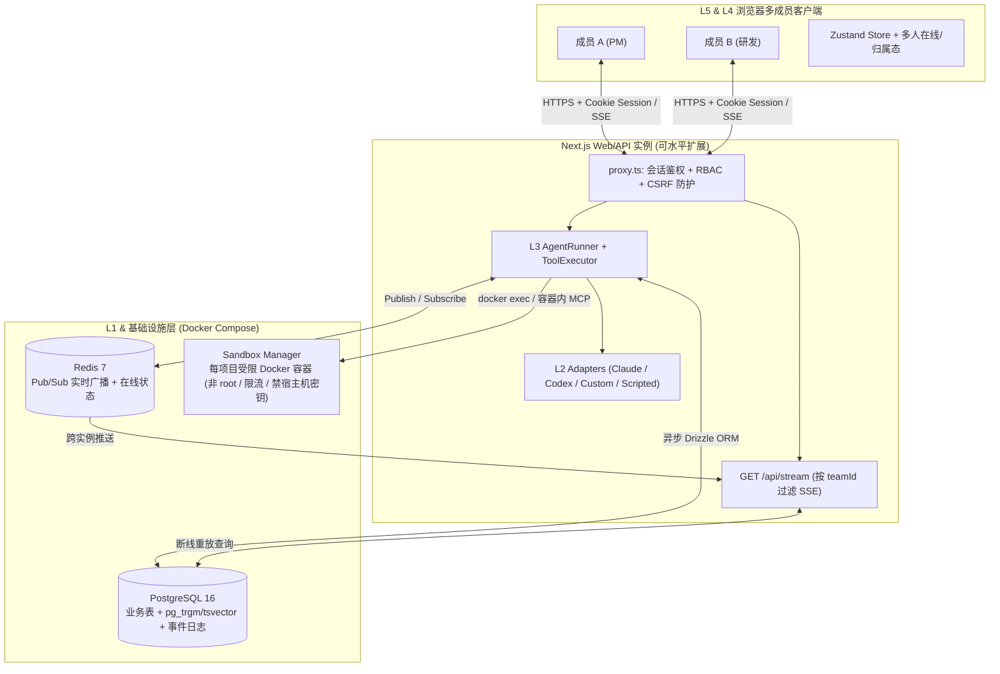

# AgentHub 产品化演进完整实施计划（M+N 团队协同标准生产档）

## 目标与产品演进总纲

本计划将当前单机个人版 AgentHub（`1 人 + N 个 Agent`，基于 `SQLite + 进程内 EventBus + 宿主机目录沙箱`）改造为面向 **2–15 人小型产品研发团队（PM + 前后端 + 设计）** 的 **M+N 人机混合协同工作台**，聚焦「需求讨论 → 原型 Web App → 代码编写 → 测试与审批交付」核心闭环。

整体采用**双阶段策略**推进：
- **Phase 1（当前仓库 `feat/team-mvp` 二开分支，4–6 周）**：以**标准生产档**落地团队账号与 RBAC、`Postgres` 异步持久化、`Redis Pub/Sub` 分布式事件流、每工作区独立 `Docker` 沙箱容器与 `CI/E2E` 质量门禁，快速跑通小团队试用并验证市场刚需。
- **Phase 2（新建独立原创仓库）**：在 Phase 1 验证成立后，剥离 Electron、Capacitor 移动端、PPT 等非核心历史包袱，基于验证成熟的五层架构与契约从零洁净重写，作为 100% 原创开源项目与面试核心作品。

---

## User Review Required

由于本次转型属于从「本机个人工具」升级为「多人网络服务端系统」，直接触及项目现有架构红线（见 [CLAUDE.md](file:///f:/Front-end/Project/bitdance-agenthub/CLAUDE.md) §2、§5、§6），以下重大变更需在动工前由你正式确认：

> [!IMPORTANT]
> **打破现有 `CLAUDE.md` 单机约束并先行更新 Spec**：现有文档明确规定“只用 SQLite 不引入 Postgres”、“不引入密钥加密存储”、“仅允许本机请求（[proxy.ts](file:///f:/Front-end/Project/bitdance-agenthub/src/proxy.ts#L8)）”。进入开发后，每个 PR 必须先同步修改 [CLAUDE.md](file:///f:/Front-end/Project/bitdance-agenthub/CLAUDE.md)、[project.md](file:///f:/Front-end/Project/bitdance-agenthub/openspec/project.md) 及对应 `specs/` 契约，再提交实现代码。

在阅读 [claude-code-adapter.ts](file:///f:/Front-end/Project/bitdance-agenthub/src/server/adapters/claude-code-adapter.ts#L34-L43) 与 [codex-adapter.ts](file:///f:/Front-end/Project/bitdance-agenthub/src/server/adapters/codex-adapter.ts#L74-L96) 时，我们还发现了一个极易踩坑的**沙箱越狱隐患**：

> [!CAUTION]
> **Claude Code SDK 与 Codex SDK 的宿主机直连风险**：`CustomAgentAdapter` 走的是项目自建的 [bash.ts](file:///f:/Front-end/Project/bitdance-agenthub/src/server/tools/bash.ts) 与 [fs-service.ts](file:///f:/Front-end/Project/bitdance-agenthub/src/server/fs-service.ts)；但 `ClaudeCodeAdapter` 和 `CodexAdapter` 会在 Next.js 所在机器直接拉起原生 CLI 子进程执行内置 `Bash/Write/Edit`。如果 PR 5 只把 `bash.ts` 放进 Docker 容器，Claude/Codex 依然会在主服务容器内执行命令，直接读取环境变量里的 `DATABASE_URL` 和主密钥！PR 5 必须禁用 SDK 宿主机内置写/Shell 工具并统一收口到指向沙箱容器的 AgentHub MCP 工具，或将 SDK Runner 整体下沉到隔离沙箱中。

此外，数据库迁移涉及大范围同步转异步改造：

> [!WARNING]
> **18 个原生 `better-sqlite3` 同步模块的异步传染**：除 Drizzle 查询外，`src/db/` 与 `src/server/` 下有 18 个模块直接导入了 `sqlite` 实例调用同步 `.prepare().get()/.run()` 及 `fts5` 虚拟表。PR 3 切 Postgres 时必须全量改为 `async/await` 并重写全文检索索引，期间冻结无关业务开发以避免合并冲突。

---

## Open Questions

在正式切分支启动 **PR 1** 前，请确认以下 3 个细节决策：

1. **团队版登录方式（PR 2）**：MVP 阶段推荐先做**「邮箱/用户名 + 密码（Argon2/Scrypt 哈希）+ 团队邀请链接」**（零外部平台依赖，`docker compose up` 开箱即用），后续再按需加 GitHub OAuth。是否认可？
2. **计划文档是否入库**：当前这份实施计划保存在工作台 Artifact 中供你审阅；审批通过切出 `feat/team-mvp` 分支后，是否需要将它同步写入仓库 `docs/TEAM-MVP-PLAN.md` 以便版本化追踪？
3. **冻结模块处理方式**：对于 Electron（`electron/`）与移动端（`mobile/`、`/api/mobile/*`），Phase 1 二开分支建议**保留代码不删、但在 CI 中跳过桌面/移动打包，仅维护 Web 服务端主链路**，避免无谓删改引发引用报错。是否同意？

---

## 架构演进全局视图



---

## Proposed Changes（分 5 个 PR 推进详解）

以下按依赖顺序拆分为 **PR 1 → PR 5**。每个 PR 均包含**具体做法**、**涉及文件**与**关键注意点**。

---

### PR 1：切分支 + 密钥加密存储 + CI 自动化门禁（第 1 周）

**目标**：建立 `feat/team-mvp` 分支；消灭数据库明文存储 API Key 的高危隐患；建立 GitHub Actions 门禁，为后续大手术提供自动化护栏。

#### 怎么做（实施步骤）
1. **切分支与更新安全规格**：从 `main` 创建 `feat/team-mvp`，更新 [CLAUDE.md](file:///f:/Front-end/Project/bitdance-agenthub/CLAUDE.md) §5.4 与 `specs/16-local-personal.md`，明确服务端模式下凭据采用 `AES-256-GCM` 信封加密。
2. **实现加解密工具模块**：基于 Node 内置 `node:crypto` 实现 `encryptSecret` / `decryptSecret`（格式：`enc:v1:<iv_b64>:<tag_b64>:<ciphertext_b64>`）。主密钥从环境变量 `AGENTHUB_MASTER_KEY`（32 字节 hex/base64）读取；开发环境若未配置则自动生成并持久化到 `.agenthub-data/master.key`（权限 `0600`），生产环境缺失则启动报错。
3. **收口所有凭据读写点**：在 `settings-service.ts`、`agent-service.ts`、`web-tool-settings.ts` 写入 DB 前加密、读取后在服务端内存解密；保留前缀判断（若旧数据未以 `enc:v1:` 开头，读取时兼容并在下次保存或启动迁移时自动升级为密文）。
4. **API 响应与日志脱敏**：核查 `/api/settings`、`/api/agents` 返回 DTO，确保前端永远只拿到 `hasApiKey: boolean` 或掩码 `sk-****1234`，绝不回传密文或明文；SSE `StreamEvent` 错误信息经过密钥正则擦除后再落库与广播。
5. **配置 GitHub Actions CI**：运行 `pnpm lint`、`pnpm typecheck`、`pnpm test`。

#### 文件级改动清单
- #### [NEW] `src/server/crypto-secrets.ts` & `src/server/crypto-secrets.test.ts`
  封装 `AES-256-GCM` 加解密、密钥派生/加载、幂等明文识别与错误文本敏感词脱敏函数 `redactSecrets(text)`。
- #### [MODIFY] [settings-service.ts](file:///f:/Front-end/Project/bitdance-agenthub/src/server/settings-service.ts)
  在 `updateAppSettings` 与 `getAppSettings` 中接入加解密（含 `anthropicApiKey`、`openaiApiKey`、`deepseekApiKey`、`arkApiKey`、`mobileDeviceToken`）。
- #### [MODIFY] [agent-service.ts](file:///f:/Front-end/Project/bitdance-agenthub/src/server/agent-service.ts) & [web-tool-settings.ts](file:///f:/Front-end/Project/bitdance-agenthub/src/server/web-tool-settings.ts)
  对 `agents.api_key` 及联网搜索工具凭据做统一加解密与 DTO 布尔标记脱敏。
- #### [NEW] `.github/workflows/ci.yml`
  Ubuntu runner + Node 22 + pnpm 缓存，串行执行 `pnpm install --frozen-lockfile`、`pnpm typecheck`、`pnpm lint`、`pnpm test`。

#### PR 1 注意点（避坑指南）
- **切勿破坏“空编辑保留原值、显式 `null` 清空”语义**：前端设置面板未改动密码框时传 `undefined`，不能把已有密文覆盖掉或把掩码字符串 `sk-****` 当成新 Key 加密写回库里！
- **主密钥丢失的灾难提示**：在 `.env.example` 与部署文档写明 `AGENTHUB_MASTER_KEY` 必须备份；一旦更换主密钥，库内已存 Key 将无法解密（解密失败时应捕获异常并提示“凭据需重新配置”，不能让整个 `/api/agents` 接口 500 崩溃）。
- **Windows 与 Linux 原生模块差异**：当前 `package.json` 的 `sqlite:ensure:host` 脚本会处理 `better-sqlite3` 编译，CI 里跑 `vitest` 前需确保触发 host native build，避免 Electron ABI 与 Node ABI 冲突报错。

---

### PR 2：M+N 团队账号、RBAC 权限与多人会话协同模型（第 1–2 周）

**目标**：解除“仅限本机单人访问”硬编码，引入多用户登录、团队（Team）隔离、角色权限（Owner / Member / Viewer），让多个真人可以在同一个房间里 `@Agent`、区分发言人身份并共同审批代码写入。

#### 怎么做（实施步骤）
1. **定义用户与团队模型**：新增 `users`、`sessions`、`teams`、`team_members`、`team_invites` 表；在 `projects`、`conversations`、`agents`（自建 Agent）上增加 `team_id`；在 `messages` 上增加 `sender_user_id`（区分是成员 A 还是成员 B 发的 user 消息）；在审批记录上增加 `resolved_by_user_id`。
2. **改造请求网关 [proxy.ts](file:///f:/Front-end/Project/bitdance-agenthub/src/proxy.ts)**：
   - 引入运行模式开关 `AGENTHUB_DEPLOYMENT_MODE=local | team`（默认 `team` 服务模式时移除 `isLocalRequest` 拦截，保留 `local` 供单机兼容）。
   - 使用 `HttpOnly; SameSite=Lax; Secure(HTTPS)` Cookie 存放高熵 Session Token，所有写操作（`POST/PUT/PATCH/DELETE`）校验 `Origin` 头防 CSRF。
3. **落地 RBAC 权限矩阵**：
   - `owner`：管理团队成员、配置团队级 API Key 与预算上限、删除项目/会话、执行一切操作。
   - `member`：创建会话、发送消息、触发 Agent、批准/拒绝 `fs_write` 与 `bash` 审批、编辑 Artifact。
   - `viewer`：只读浏览会话、产物预览与代码树，不可触发消耗 Token 的 Run 或批准高危操作。
4. **改造前端多人体验**：
   - 新增 `/login`、`/register`、团队切换器与邀请链接弹窗。
   - 改造 [message-item.tsx](file:///f:/Front-end/Project/bitdance-agenthub/src/components/message-item.tsx) 与 [pending-writes-panel.tsx](file:///f:/Front-end/Project/bitdance-agenthub/src/components/pending-writes-panel.tsx)：人类消息不再统一显示为匿名“我”，而是展示具体发送成员的头像与昵称；审批卡片展示“已由 @张三 批准”。

#### 文件级改动清单
- #### [MODIFY] [schema.ts](file:///f:/Front-end/Project/bitdance-agenthub/src/db/schema.ts) & [shared/types.ts](file:///f:/Front-end/Project/bitdance-agenthub/src/shared/types.ts)
  新增用户/团队/会话鉴权表定义；扩展 `Message` 与 `StreamEvent` 携带 `senderUser?: { id, name, avatar }` 与 `teamId`。
- #### [NEW] `src/server/auth-service.ts` & `src/server/rbac.ts`
  基于 `node:crypto.scrypt` 实现密码哈希、Session 签发/续期/吊销，以及统一的路由守卫 `requireTeamRole(req, teamId, minRole)`。
- #### [MODIFY] [proxy.ts](file:///f:/Front-end/Project/bitdance-agenthub/src/proxy.ts)
  支持 `/login`、`/api/auth/*` 放行，校验用户登录态 Cookie 与写接口 `Origin` 校验。
- #### [NEW] `src/app/login/page.tsx` & `src/app/api/auth/{login,register,logout,me}/route.ts` & `src/app/api/teams/**`
  登录注册页、当前用户信息接口、团队创建与邀请加入接口。
- #### [MODIFY] `src/app/api/conversations/**` & [conversation-service.ts](file:///f:/Front-end/Project/bitdance-agenthub/src/server/conversation-service.ts)
  所有查询强制附带 `where team_id = currentTeamId`，杜绝跨团队 ID 枚举越权（IDOR）。

#### PR 2 注意点（避坑指南）
- **严防 IDOR（越权访问漏洞）**：绝不能只靠前端隐藏别的团队列表！每一个带 `[id]` 的 API（如 `/api/conversations/[id]`、`/api/artifacts/[id]`、`/api/runs/[id]/abort`、`/api/deployments/[id]`）都必须在服务端校验该资源所属的 `teamId` 与当前登录用户的 `team_members` 关系。
- **内置 Agent（Builtin Agents）的归属设计**：`BUILTIN_AGENTS`（如 Orchestrator、Frontend Engineer）应当是 `team_id = NULL`（全局只读共享模板），而团队自建的 Agent 和配置的 `apiKey` 必须绑定具体的 `team_id`，绝不能让 A 团队改了内置 Agent 的 `api_key` 被 B 团队读到！因此团队对内置 Agent 的 Key 覆盖应拆到独立的 `team_agent_configs(team_id, agent_id, api_key, ...)` 表。
- **LLM 上下文里的多人身份感知**：在 [conversation-context.ts](file:///f:/Front-end/Project/bitdance-agenthub/src/server/conversation-context.ts) 序列化历史消息给 LLM 时，要把人类消息格式化为 `[PM 张三]: 我们需要加个筛选器`、`[前端 李四]: 接口字段叫 status`，否则 Agent 分不清群里是两个不同角色的人在说话！
- **并发审批竞态**：成员 A 点“批准写入”的同时成员 B 点“拒绝”，服务端必须做原子状态流转（只认第一个处理结果并广播状态变更，第二个返回 `409 Already resolved by 张三`）。

---

### PR 3：L1 数据层异步化与 SQLite → PostgreSQL 迁移（第 2–3 周）

**目标**：彻底解决单文件 SQLite 无法支撑多实例并发写入的问题，将 ORM 与全部 18 个原生 SQL 模块平滑迁移至 PostgreSQL 16。

#### 怎么做（实施步骤）
1. **引入 `pg` 与异步 Drizzle 客户端**：新增依赖 `pg` 与 `@types/pg`，改造 `src/db/client.ts` 使用连接池 `pg.Pool` + `drizzle-orm/node-postgres`，移除模块顶层同步 `bootstrapDatabase(sqlite)`，改为在 Next.js [instrumentation.ts](file:///f:/Front-end/Project/bitdance-agenthub/src/instrumentation.ts) `register()` 钩子或独立迁移脚本中异步执行版本化 Drizzle Migration + Builtin Seed。
2. **重写 Schema 类型映射**：将 `sqliteTable` 迁移为 `pgTable`：
   - JSON 字符串列（`parts`、`capabilities`、`usage`）升级为原生 **`jsonb`**（查询性能与索引能力大幅提升）。
   - 时间戳统一使用 `bigint(..., { mode: 'number' })` 毫秒时间戳，保持前后端类型零改动。
   - 自增主键（`stream_events.id`、`auxiliary_usage.id`）升级为 `bigserial`。
3. **逐一清理 18 个原生 `sqlite` 同步调用模块**：
   - 将 [event-journal.ts](file:///f:/Front-end/Project/bitdance-agenthub/src/server/event-journal.ts)、[message-queue.ts](file:///f:/Front-end/Project/bitdance-agenthub/src/server/message-queue.ts)、[context-checkpoints.ts](file:///f:/Front-end/Project/bitdance-agenthub/src/server/context-checkpoints.ts)、[recovery-service.ts](file:///f:/Front-end/Project/bitdance-agenthub/src/server/recovery-service.ts) 等全部改写为异步 Drizzle/SQL 查询。
   - 消息队列出队（`conversation_message_queue`）改用 Postgres `SELECT ... FOR UPDATE SKIP LOCKED`，防止多节点重复消费同一条排队消息。
4. **全文检索迁移（SQLite `fts5` → Postgres `pg_trgm`）**：
   - 原 [message-search-schema.ts](file:///f:/Front-end/Project/bitdance-agenthub/src/db/message-search-schema.ts) 用的是 `fts5(tokenize='trigram')` 以同时支持中英文子串搜索。
   - Postgres 默认的 `to_tsvector('simple', ...)` 对**中文无分词**，直接替换会导致中文搜索彻底失效！因此在 Postgres 中启用 **`CREATE EXTENSION IF NOT EXISTS pg_trgm`**，新增生成列或触发器维护提取出的纯文本列 `search_text`，并建立 `GIN (search_text gin_trgm_ops)` 索引，完美对齐原有的中英文三元组模糊/关键词检索体验！

#### 文件级改动清单
- #### [MODIFY] [client.ts](file:///f:/Front-end/Project/bitdance-agenthub/src/db/client.ts) & [schema.ts](file:///f:/Front-end/Project/bitdance-agenthub/src/db/schema.ts) & `drizzle.config.ts`
  切换为 `pg.Pool` 与 `pgTable`；配置标准 `drizzle-kit generate / migrate` 目录 `drizzle/`。
- #### [MODIFY] [instrumentation.ts](file:///f:/Front-end/Project/bitdance-agenthub/src/instrumentation.ts) & [bootstrap.ts](file:///f:/Front-end/Project/bitdance-agenthub/src/db/bootstrap.ts)
  启动时异步执行 schema 校验/迁移、Builtin Agents 幂等 `ON CONFLICT DO NOTHING` 初始化，以及中断 Run 状态对账恢复。
- #### [MODIFY] [search-service.ts](file:///f:/Front-end/Project/bitdance-agenthub/src/server/search-service.ts) & [message-search-schema.ts](file:///f:/Front-end/Project/bitdance-agenthub/src/db/message-search-schema.ts)
  替换为 Postgres `pg_trgm` + `ILIKE` / 相似度排序查询，并附带 `team_id` 过滤。
- #### [MODIFY] 其余直接引用 `sqlite` 的服务与单元测试（共约 18 个文件）
  统一改为依赖注入异步 `DbClient`；单元测试支持基于 `PGlite`（纯内存 WASM Postgres，无需本地起 Docker 即可毫秒级跑 Vitest！）或测试库运行。
- #### [NEW] `docker-compose.dev.yml`
  提供本地开发用的 `postgres:16-alpine` 与 `redis:7-alpine` 一键启动编排。

#### PR 3 注意点（避坑指南）
- **单元测试速度保卫战**：以前单测快是因为 `new Database(':memory:')` 只要 1ms。切 Postgres 后如果每个测试都连真实外部容器会变慢且难并行——强烈建议在 `devDependencies` 引入 **`@electric-sql/pglite`**（Drizzle 官方原生支持 `drizzle-orm/pglite`），单测在内存里跑真 Postgres 语法（含 `pg_trgm` 扩展！），CI 再加一轮真实 `postgres:16` 集成测试，两全其美。
- **`eventBus.publish` 变异步后的流式顺序保证**：流式输出（`part.delta`）每秒可能触发几十次。如果调用方不 `await publish()` 直接并发写 Postgres，网络抖动会导致后发的 delta 先落库、序号颠倒！解决方案：在每个 `runId` 内部维护一个轻量内存串行 Promise 链（或对高频 `part.delta` 做 30–50ms 微批合并后再持久化与广播，这还能把 DB 写压力降低 80%！）。
- **Next.js HMR 连接池泄漏**：开发模式下热更新会反复重跑模块，必须在 `globalThis.__agenthubPgPool` 上挂载单例并限制 `max: 10`，否则保存十几次代码就会报 `too many clients already`。

---

### PR 4：L3/L4 实时总线升级：内存 EventBus → Redis Pub/Sub（第 3–4 周）

**目标**：让多个团队成员（甚至连接到不同后端容器实例）在同一毫秒看到 Agent 的思考流、代码生成流、成员新消息与在线协同状态，且断网重连不丢包。

#### 怎么做（实施步骤）
1. **重构 [event-bus.ts](file:///f:/Front-end/Project/bitdance-agenthub/src/server/event-bus.ts) 为双层架构**：
   - 发布端 `await eventBus.publish(teamId, event)`：先写入 Postgres `stream_events(id, team_id, conversation_id, event)` 拿到全局严格递增 `id`，再通过 Redis `PUBLISH agenthub:team:<teamId>` 广播 `{ id, event }`。
   - 订阅端：每个 Next.js 进程维护**一条共享的 Redis Subscriber 连接**，按当前活跃 SSE 客户端所在的 `teamId` 按需 `SUBSCRIBE`，在进程内扇出给对应成员的 `ReadableStream`。
2. **改造 [stream/route.ts](file:///f:/Front-end/Project/bitdance-agenthub/src/app/api/stream/route.ts) 断线重放与租户隔离**：
   - 建立 SSE 连接时校验当前用户所属 `teamId`。
   - 订阅 Redis **先于** 查询 `Last-Event-ID` 补包（保留现有防漏包时序设计，并对 `id <= replayMaxId` 的重复实时包去重）。
   - `streamSnapshot()` 只返回当前 `teamId` 下的运行态快照。
3. **新增轻量团队在线状态（Presence）**：
   - 利用 Redis `SETEX` / Hash 记录某会话当前正在查看的成员列表，前端聊天顶部展示“当前在线：张三、李四 + 3 个 Agent”。

#### 文件级改动清单
- #### [MODIFY] [event-bus.ts](file:///f:/Front-end/Project/bitdance-agenthub/src/server/event-bus.ts) & [event-journal.ts](file:///f:/Front-end/Project/bitdance-agenthub/src/server/event-journal.ts)
  接入 `ioredis`（支持优雅降级：若未配 `REDIS_URL` 自动退回进程内 `EventEmitter`，方便极简开发调试）。
- #### [MODIFY] [stream/route.ts](file:///f:/Front-end/Project/bitdance-agenthub/src/app/api/stream/route.ts) & [stream-snapshot.ts](file:///f:/Front-end/Project/bitdance-agenthub/src/server/stream-snapshot.ts)
  强制按 `teamId` 过滤重放日志与初始快照；心跳时校验 Session 有效性，成员被移出团队后 15s 内自动掐断 SSE 流。

#### PR 4 注意点（避坑指南）
- **绝对不要每个浏览器 SSE 连接新建一个 Redis 连接**：100 个用户开网页就会耗尽 Redis 连接数！必须由服务端单例复用 **1 个 Publisher + 1 个 Subscriber**，在 Node 内存里做二级分发。
- **重放窗口与定期清理**：`stream_events` 表高频写入，若每次 `INSERT` 都跑同步 `DELETE WHERE id <= id - 10000` 在高并发下会引发行锁争用。改为后台每 5 分钟异步批量清理一次过期事件日志。

---

### PR 5：每项目独立 Docker 沙箱执行器与一键生产交付（第 4–6 周）

**目标**：彻底隔离 Agent 的文件系统与命令执行环境，确保团队成员共享同一个云端/服务端代码工作区，且任何恶意 Prompt 注入都打不穿宿主机与其他团队数据。

#### 怎么做（实施步骤）
1. **设计 `SandboxManager`（容器生命周期管理）**：
   - 每个 `Project`（或独立 `Conversation` 工作区）对应宿主机/存储卷上的独立子目录，以及一个按需拉起的受限容器 `agenthub-sbx-<workspaceId>`（基础镜像预装 `node:22`、`pnpm`、`git`、`python3`、常用构建工具，以非特权用户 `uid=1000` 运行）。
   - 容器安全加固参数：
     - `--cap-drop=ALL`、`--security-opt=no-new-privileges`
     - `--cpus="1.0" --memory="1g" --pids-limit=256`（防 Fork 炸弹与内存打爆）
     - 仅挂载当前项目工作区卷到 `/workspace`，**绝不注入** `DATABASE_URL`、`REDIS_URL`、`AGENTHUB_MASTER_KEY` 或其他团队目录。
     - 空闲 15 分钟自动 `docker stop` 释放内存，下次调用工具时秒级唤醒（卷数据持久保留）。
2. **改造工具执行链路与封堵 SDK 原生越狱口**：
   - [bash.ts](file:///f:/Front-end/Project/bitdance-agenthub/src/server/tools/bash.ts) 在团队沙箱模式下不再调宿主机 `powershell.exe` / `zsh`，而是执行 `docker exec -i -u sandbox -w /workspace/<relCwd> <containerId> sh -c <cmd>`，超时或 Abort 时精确清理容器内进程树。
   - **封堵 Claude Code / Codex SDK 宿主机直连**：在团队模式下，禁用 `ClaudeCodeAdapter` 内置宿主机 `Bash/Write/Edit/Read` 工具（`disallowedTools`），统一暴露绑定到容器沙箱的 AgentHub MCP 工具集（`fs_read`、`fs_write`、`fs_list`、`bash`），确保三大 Adapter 100% 走同一套安全边界与团队审批流！
3. **打通团队共享 Web 预览与 Git 工作流**：
   - 成员 A 让前端 Agent 在沙箱里跑 `pnpm build` 生成静态产物后，`deploy_workspace` 生成团队内鉴权可见的预览链接 `/deployments/[id]/`，PM 和设计师点开就能直接在浏览器里验收交互原型。
   - 支持在项目设置中配置 Git 仓库 URL 与 Deploy Key / Token，一键在沙箱内拉取代码、切分支提交。
4. **交付全栈 `docker-compose.yml` 与 `ScriptedAdapter` 多人 E2E**：
   - 编写生产级 `Dockerfile`（Next.js standalone）+ `docker-compose.yml`（`web` + `postgres` + `redis` + `sandbox-proxy/socket-proxy`）。
   - 实现测试专用的 `ScriptedAdapter`，用 Playwright 启动两个独立浏览器 Context（模拟 PM 张三与研发李四）跑通完整协同验收用例。

#### 文件级改动清单
- #### [NEW] `src/server/sandbox/sandbox-manager.ts` & `docker/sandbox.Dockerfile`
  容器创建、唤醒、空闲回收、资源配额与命令流式执行封装。
- #### [MODIFY] [bash.ts](file:///f:/Front-end/Project/bitdance-agenthub/src/server/tools/bash.ts) & [fs-service.ts](file:///f:/Front-end/Project/bitdance-agenthub/src/server/fs-service.ts)
  对接 `SandboxManager`；移除服务端的本地目录拾取器（`/api/fs/listdir` 在团队模式下禁用，防止探测服务器宿主机目录！）。
- #### [MODIFY] [claude-code-adapter.ts](file:///f:/Front-end/Project/bitdance-agenthub/src/server/adapters/claude-code-adapter.ts) & [codex-adapter.ts](file:///f:/Front-end/Project/bitdance-agenthub/src/server/adapters/codex-adapter.ts)
  团队模式下收口工具执行权至 AgentHub 沙箱工具层，隔离 SDK 临时会话目录按 `teamId` 分桶。
- #### [NEW] `Dockerfile` & `docker-compose.yml` & `.env.production.example`
  生产一键部署清单（内置 `tecnativa/docker-socket-proxy` 限制 `web` 容器对 Docker Daemon 的权限，避免直接裸挂 `/var/run/docker.sock` 等同交出宿主机 root）。
- #### [NEW] `src/server/adapters/scripted-adapter.ts` & `e2e/team-collaboration.spec.ts`
  可编程测试假 Adapter + 双用户同房间 `@Agent`、审批同步、跨团队越权拦截 E2E 测试。

#### PR 5 注意点（避坑指南）
- **千万别把 `/var/run/docker.sock` 直接裸挂给可被外部访问的业务容器而不做隔离**：在 `docker-compose.yml` 中加一层极轻量的 `docker-socket-proxy`（仅允许管理带 `label=app=agenthub-sandbox` 的容器，禁止挂载宿主机 `/` 目录或启动 `--privileged` 容器），这是面试时讲安全架构的杀手级加分项！
- **必须关闭团队模式下的 `/api/fs/listdir` 任意目录浏览接口**：单机版为了选本地文件夹暴露了盘符浏览接口，到了多人服务端如果不关掉，普通成员就能浏览你整个 Linux 服务器的目录结构！
- **预算熔断兜底**：在 `team_settings` 增加每日/单会话最大 Token 限额，Orchestrator 并行派发子任务前检查团队剩余额度，防止死循环把团队公共 API Key 刷爆。

---

### 附：Phase 2 新建原创项目重写指引（验证完成后启动）

当 Phase 1 在 `feat/team-mvp` 跑通并收集完种子团队反馈后，新建独立仓库时按以下原则取舍，确保 **100% 原创代码 + 架构极致干净**：
- **直接舍弃的历史包袱**：`electron/` 桌面壳、`mobile/` Capacitor 壳、PPT 主题/导出链路、SQLite 同步兼容补丁、单机本地目录拾取器、零散的历史 `migrate-add-*.ts` 脚本。
- **从第一天就原生设计的亮点**：纯异步 `Postgres + Drizzle` Schema、一等公民的 `Team / User / Role / Project` 实体、统一协议的 `StreamEvent v2`（原生含序列号、租户与操作人归属）、基于 MCP 标准的统一沙箱执行协议（让任何模型只通过标准工具协议触碰隔离容器）。

---

## Verification Plan

### Automated Tests

每个 PR 合并前必须通过以下命令验证：

```powershell
# 1. 静态类型与代码规范检查
pnpm typecheck
pnpm lint

# 2. 单元测试与契约测试（加解密、RBAC 越权拦截、搜索、事件重放、沙箱命令限制）
pnpm test

# 3. 团队协同端到端测试（PR 5 完成后执行，包含双浏览器 Context 实时协同验证）
pnpm playwright test e2e/team-collaboration.spec.ts
```

### Manual Verification

1. **密钥安全验证（PR 1）**：在设置面板填入测试 API Key 后，直接打开数据库查看 `app_settings` 与 `agents` 表，确认字段值为 `enc:v1:...` 密文；打开浏览器 DevTools Network 面板检查 `/api/settings` 与 `/api/agents` 响应体，确认不包含任何明文或密文 Key。
2. **多人实时协同与越权验证（PR 2–PR 4）**：
   - 用普通窗口登录“PM 张三”创建团队与会话，用无痕窗口登录“前端 李四”通过邀请链接加入同一团队。
   - 张三发送需求并 `@Orchestrator`，验证李四窗口无需刷新即可实时看到张三头像消息、任务拆解卡与流式代码生成。
   - 当 Agent 发起 `fs_write` 审批时，由李四点击“批准”，验证张三窗口审批卡同步变为“已由李四批准”且 Run 自动继续执行。
   - 注册第三个账号“外部王五”（不属于该团队），尝试直接请求张三的 `/api/conversations/<id>` 与 `/api/deployments/<id>`，确认全部返回 `403/404`。
3. **Docker 沙箱逃逸与资源限制测试（PR 5）**：
   - 执行 `docker compose up -d` 一键拉起全套服务。
   - 让 Agent 在会话中尝试执行 `env`、`cat /etc/passwd`、`ls ..` 以及跨目录读取，确认容器内完全看不到宿主机的 `DATABASE_URL` / `AGENTHUB_MASTER_KEY`，且文件操作严格限制在 `/workspace` 内。
